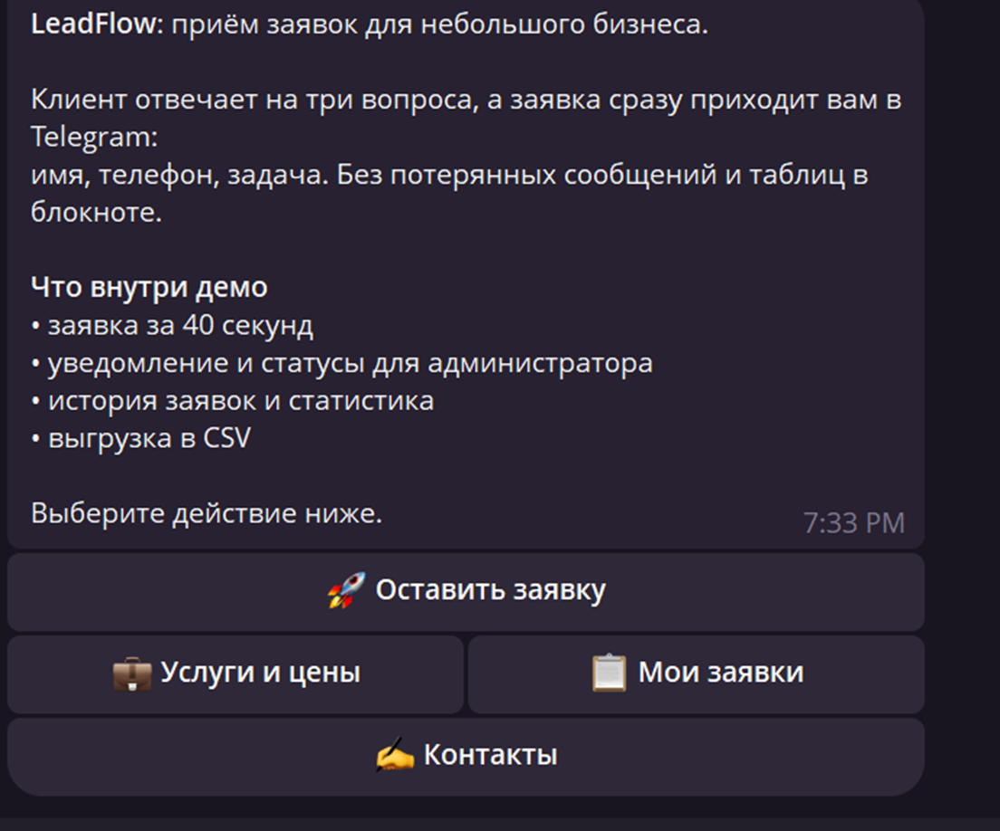
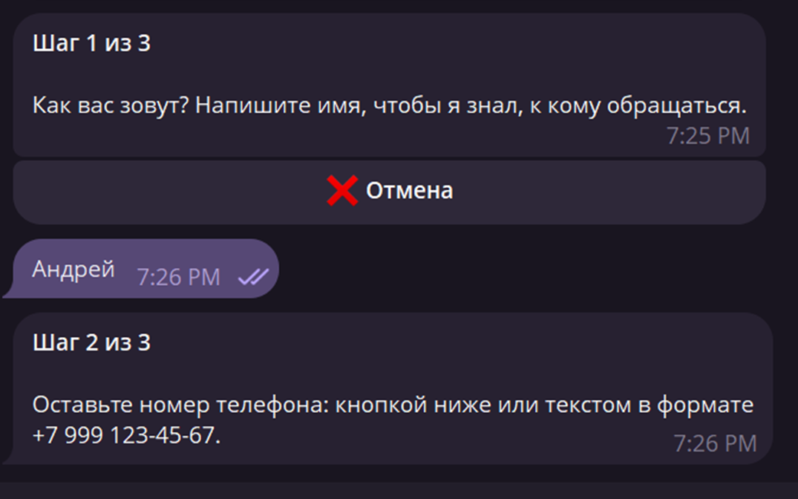
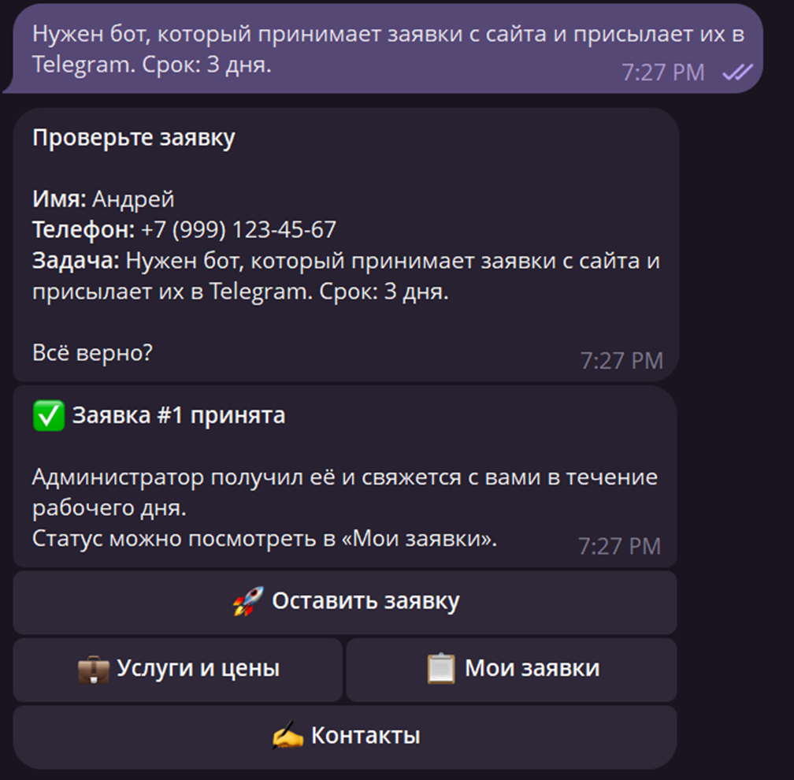
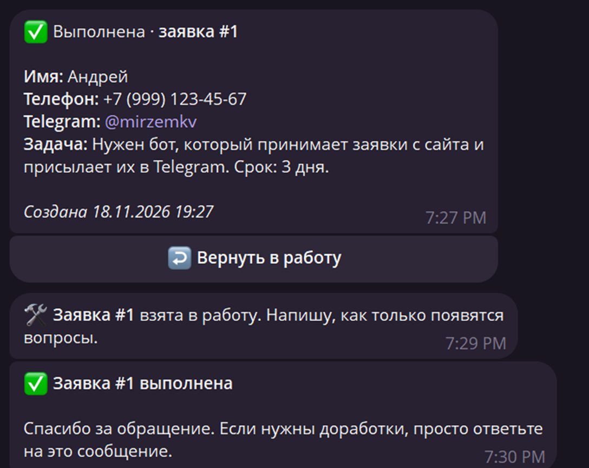
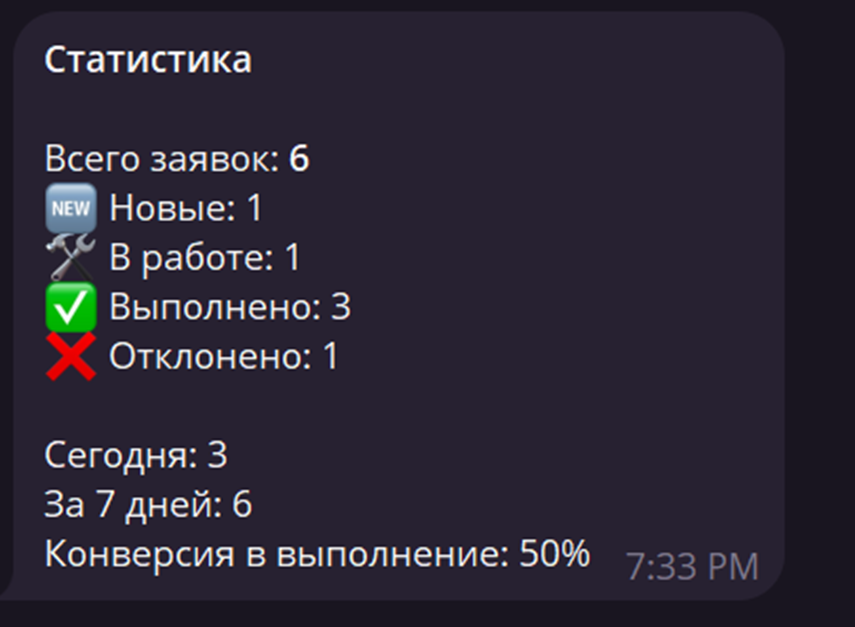
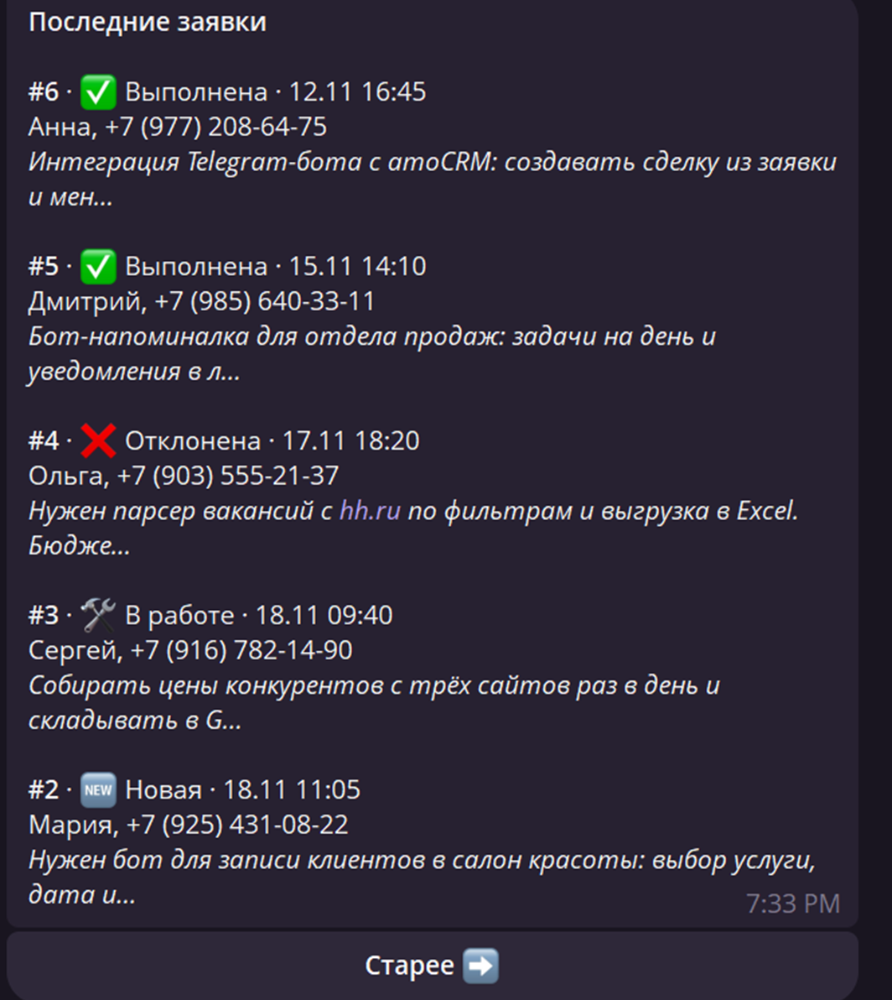
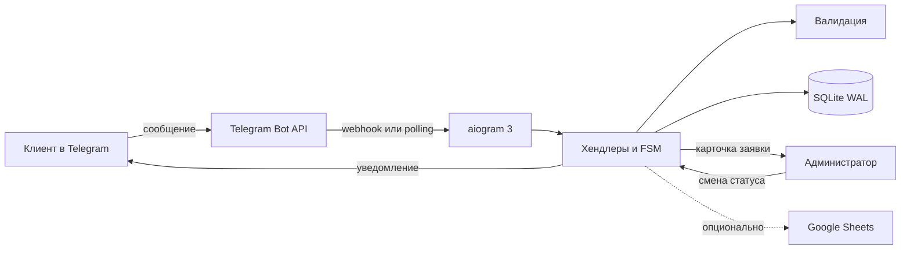

# LeadFlow: Telegram-бот приёма заявок

[](https://www.python.org/)
[](https://docs.aiogram.dev/)
[](LICENSE)

Бот, который превращает переписку в заявки: клиент проходит три шага, администратор получает карточку с телефоном и задачей, меняет статус одним нажатием и выгружает всё в CSV.

Это не учебный «hello world». Проект собран как небольшой продакшн-сервис: валидация ввода, защита от флуда, роли, обработка ошибок, два режима запуска (polling и webhook), тесты и линтер.

## Демо

Живой бот: [@leadflow_mirzemkv_bot](https://t.me/leadflow_mirzemkv_bot).

Что попробовать:

- `/start` и кнопка «Оставить заявку»: три шага, проверка телефона, подтверждение;
- `/leads`: список заявок и смена статусов;
- `/stats`: сводка по статусам и конверсии;
- `/export`: выгрузка в CSV.

Демо работает в режиме long polling. Для постоянной работы бот разворачивается на Render по инструкции ниже и сам переходит на webhook.

## Скриншоты

| Клиент: меню | Клиент: шаги заявки |
|---|---|
|  |  |
| **Подтверждение и приём заявки** | **Карточка администратора: выполнение** |
|  |  |
| **Статистика** | **Список заявок** |
|  |  |

## Возможности

**Для клиента**

- заявка за три шага: имя, телефон, задача;
- кнопка «Отправить мой номер»: не нужно вводить цифры вручную;
- проверка телефона и текста, понятные подсказки при ошибке;
- статус своих заявок в разделе «Мои заявки»;
- уведомление, когда заявку взяли в работу или закрыли.

**Для администратора**

- карточка новой заявки приходит в Telegram сразу после отправки;
- статусы: новая, в работе, выполнена, отклонена;
- защита от неверных переходов между статусами;
- `/leads`: последние заявки с постраничной навигацией;
- `/stats`: сводка за сегодня, неделю и конверсия в выполнение;
- `/export`: выгрузка всех заявок в CSV (Excel и Google Sheets открывают без танцев).

**Инженерная часть**

- aiogram 3, полностью асинхронный код;
- SQLite с WAL: данные не теряются при перезапуске;
- throttling: одно событие в 0.7 секунды на пользователя;
- лимит 3 заявки в сутки с одного аккаунта;
- секрет в webhook-пути и заголовке `X-Telegram-Bot-Api-Secret-Token`;
- опциональный экспорт в Google Sheets через Apps Script;
- health-check `/healthz` для хостинга;
- Docker и Render Blueprint;
- 13 тестов на валидацию и хранилище.

## Как это устроено



Сценарий заявки хранится в FSM: бот не принимает «телефон» на шаге имени и не теряет данные между шагами. После подтверждения заявка записывается в базу, администратор получает карточку, а клиент: номер заявки и кнопку возврата в меню.

## Стек

| Слой | Технология |
|---|---|
| Бот | Python 3.11+, aiogram 3.32 |
| Хранилище | SQLite (aiosqlite), WAL |
| Настройки | pydantic-settings, `.env` |
| HTTP для webhook | aiohttp |
| Качество | pytest, pytest-asyncio, ruff |
| Деплой | Render (бесплатный план) или Docker |

## Быстрый старт

```bash
git clone https://github.com/mirzemkv/tg-lead-bot.git
cd tg-lead-bot

python -m venv .venv
# Windows
.venv\Scripts\activate
# macOS / Linux
source .venv/bin/activate

pip install -r requirements.txt
cp .env.example .env
```

Дальше:

1. Откройте [@BotFather](https://t.me/BotFather), выполните `/newbot` и скопируйте токен.
2. Узнайте свой ID в [@userinfobot](https://t.me/userinfobot).
3. Впишите `BOT_TOKEN` и `ADMIN_IDS` в `.env`.
4. Запустите бота:

```bash
python -m app
```

Без `WEBHOOK_BASE_URL` бот работает через long polling: удобно для разработки, ничего дополнительно настраивать не нужно.

Если в сети нужен прокси, укажите `PROXY_URL` и установите `aiohttp-socks`:

```bash
pip install "aiohttp-socks>=0.9"
```

## Переменные окружения

| Переменная | Обязательна | По умолчанию | Назначение |
|---|---|---|---|
| `BOT_TOKEN` | да | — | токен от BotFather |
| `ADMIN_IDS` | для уведомлений | — | ID администраторов через запятую |
| `DB_PATH` | нет | `data/leadbot.sqlite3` | путь к базе |
| `WEBHOOK_BASE_URL` | нет | — | пусто = polling; на Render подставляется автоматически |
| `WEBHOOK_SECRET` | для webhook | `change-me` | секрет пути и заголовка Telegram |
| `PORT` | нет | `8080` | порт HTTP-сервера |
| `SHEETS_WEBHOOK_URL` | нет | — | URL Apps Script для выгрузки |
| `PROXY_URL` | нет | — | HTTP/SOCKS-прокси для локального запуска |
| `LOG_LEVEL` | нет | `INFO` | уровень логов |
| `RATE_LIMIT_SECONDS` | нет | `0.7` | минимальный интервал между событиями |
| `DAILY_LEAD_LIMIT` | нет | `3` | лимит заявок с одного аккаунта за 24 часа |
| `SUPPORT_CONTACT` | нет | `@leadflow_support` | контакт в текстах |

## Деплой на Render

В репозитории есть `render.yaml`, поэтому Render сам создаст web-сервис, включит health-check и сгенерирует `WEBHOOK_SECRET`.

1. Зарегистрируйтесь на [render.com](https://render.com) через GitHub.
2. **New → Blueprint**, выберите репозиторий `tg-lead-bot`.
3. Заполните `BOT_TOKEN` и `ADMIN_IDS`.
4. Нажмите **Apply**. Через пару минут бот поднимется, а webhook установится сам из `RENDER_EXTERNAL_URL`.

Особенности бесплатного плана: сервис засыпает после 15 минут без запросов. Telegram хранит обновления до 24 часов и дошлёт их после пробуждения, но первое сообщение может подождать 30–60 секунд. Для боевого проекта с клиентами лучше платный инстанс или VPS за 300–500 ₽/мес.

Файловая система на бесплатном плане эфемерная: база переживёт сон, но не новый деплой. Для продакшена подключите Postgres или Render Disk.

## Docker и VPS

```bash
docker build -t tg-lead-bot .
docker run -d --name leadbot --env-file .env -p 8080:8080 -v "$PWD/data:/app/data" tg-lead-bot
```

Для webhook за reverse-proxy задайте:

```env
WEBHOOK_BASE_URL=https://bot.example.com
WEBHOOK_SECRET=длинная-случайная-строка
```

Nginx проксирует `https://bot.example.com` на `127.0.0.1:8080`, HTTPS можно получить через Let's Encrypt. Polling за прокси не нужен: это исходящие запросы к Telegram.

## Google Sheets

1. Создайте таблицу и лист `Заявки`.
2. **Расширения → Apps Script**, вставьте код:

```javascript
function doPost(e) {
  const data = JSON.parse(e.postData.contents);
  const sheet = SpreadsheetApp.getActiveSpreadsheet().getSheetByName('Заявки');
  sheet.appendRow([
    data.id,
    new Date(data.created_at),
    data.name,
    data.phone,
    data.username,
    data.task,
    data.status,
  ]);
  return ContentService.createTextOutput('ok');
}
```

3. **Развернуть → Новое развёртывание → Веб-приложение**, доступ «для всех».
4. Скопируйте URL в `SHEETS_WEBHOOK_URL`.

Экспорт не блокирует приём заявок: если Apps Script недоступен, заявка всё равно сохранится в базе.

## Тесты и качество

```bash
pytest -q        # 13 тестов
ruff check .     # линтер
ruff format --check .
```

Тесты не зависят от Telegram: проверяются валидаторы и хранилище, поэтому идут за доли секунды.

## Структура проекта

```
app/
  __main__.py        точка входа: polling или webhook
  config.py          настройки и валидация env
  models.py          заявка, статусы, разрешённые переходы
  db.py              SQLite: заявки, статистика, CSV
  content.py         все тексты интерфейса
  keyboards.py       inline и reply-клавиатуры
  validators.py      телефон, имя, описание задачи
  middlewares.py     throttling
  filters.py         проверка прав администратора
  handlers/
    common.py        меню, услуги, контакты, история
    leads.py         FSM-сценарий заявки
    admin.py         статусы, статистика, выгрузка
  services/
    notify.py        уведомления администраторов
    sheets.py        экспорт в Google Sheets
  web.py             aiohttp: health-check и webhook
tests/
  test_validators.py
  test_db.py
```

## Решения, которые стоит объяснить

**Почему SQLite, а не Postgres.** До сотен заявок в день SQLite с WAL быстрее и дешевле: один файл, ноль администрирования. Драйвер асинхронный, запись под замком. Когда появятся несколько инстансов, `Storage` меняется на Postgres без переписывания хендлеров.

**Почему FSM, а не диалог в одном сообщении.** Состояние явное: невозможно записать имя в поле телефона. При этом FSM в памяти: для одного инстанса этого достаточно, для нескольких нужен Redis.

**Почему два режима запуска.** Polling: разработка на ноутбуке без домена. Webhook: хостинг, health-check, мгновенная доставка. Переключение одной переменной окружения.

**Почему тексты в отдельном модуле.** Клиент часто просит «поменять это слово». Правка в одном файле дешевле, чем поиск строк по хендлерам.

## Что доработаем под ваш бизнес

Демо показывает базу: сценарий, статусы, статистику и выгрузку. В рабочем проекте под клиента обычно добавляют:

| Доработка | Что даёт | Срок |
|---|---|---|
| Интеграция с amoCRM или Bitrix24 | заявка сразу создаёт сделку и двигается по этапам | 1-2 дня |
| Оплата и запись | ЮKassa, Telegram Payments, выбор слота и напоминание | 2-3 дня |
| Свой домен и webhook | работа 24/7 без спящего режима | 1 день |
| Postgres и Redis | несколько инстансов, данные не теряются при деплое | 1-2 дня |
| Админ-веб-панель | фильтры, поиск, экспорт без команд в чате | 3-5 дней |
| Мультиязычность | русский и английский в одном боте | 1 день |
| Метрики и алерты | видно конверсию, ошибки и падения без логов в консоли | 1-2 дня |

Цены и состав фиксируются в ТЗ до начала работы. Демо можно взять как основу и не писать приём заявок с нуля.

## Ограничения демо

- FSM в памяти: после рестарта незавершённая заявка сбрасывается.
- SQLite на бесплатном Render не переживает redeploy.
- Уведомления только в Telegram: нет email и вебхуков в CRM.
- Демо работает на тестовом контуре, без круглосуточного мониторинга.

Дальше по плану: Postgres и Alembic, Redis для FSM, интеграция с amoCRM и Bitrix24, админ-веб-панель, метрики Prometheus.

## Лицензия

MIT. Берите код, переделывайте под свой бизнес, ставьте клиентам. Если проект помог: поставьте звезду и напишите, что получилось.
